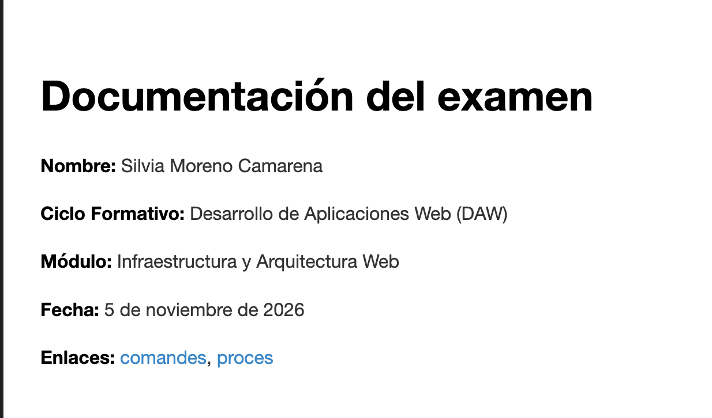

# Proceso de trabajo

## 1. Creación y clonación del repositorio

# Proceso de trabajo ( AQUÍ FALTA AÑADIR TABLAS, LISTAS, ENLACES, IMÁGENES Y CÓDIGO)

## 5. Elementos de Markdown utilizados

### Tabla

| Comando | Descripción |
|---|---|
| `git init` | Crea un repositorio |
| `git status` | Muestra el estado del repositorio |

### Lista

- Crear el repositorio.
- Crear las ramas.
- Crear la documentación.
- Publicar el proyecto.

### Enlace

[Repositorio del examen](https://github.com/espemm/UD01_exam_IAW)

[Documentación de MkDocs](https://www.mkdocs.org/)

### Imagen



### Código

```bash
git status
git add .
git commit -m "Actualizar documentación"
git push
```

## 1. Creación y clonación del repositorio

AÑADIR ANOTACIONES DEL LIBREOFFICE

Primero creé una carpeta llamada `PracticaExamen` en mi ordenador y la abrí con Visual Studio Code.

Inicialicé el repositorio local utilizando el comando

```bash
git init
```

A continuación, cloné el repositorio del profesor desde GitHub

```bash
git clone https://github.com/espemm/UD01_exam_IAW.git
```

Después copié el archivo `UD01_exam.md` del repositorio clonado a la carpeta principal de mi proyecto

```bash
cp UD01_exam_IAW/UD01_exam.md .
```

Por último, añadí el archivo al control de versiones y realicé el primer commit

```bash
git add UD01_exam.md
git commit -m "Añadir enunciado del examen"
```

De esta manera, preparé mi repositorio local con el enunciado original del examen.

## 2. Creación y gestión de ramas

El repositorio principal se creó en la rama `main`, donde guardé el enunciado original del examen.

Después publiqué el repositorio en GitHub utilizando Visual Studio Code.

A continuación, creé una nueva rama llamada `documentacion` para trabajar en el proyecto MkDocs sin modificar la rama principal.

Utilicé el siguiente comando

```bash
git checkout -b documentacion
```

Este comando crea una nueva rama y cambia automáticamente a ella.

Para comprobar las ramas disponibles y saber en cuál estoy trabajando, utilicé

```bash
git branch
```

La rama activa aparece marcada con un asterisco (`*`).

## 3. Creación y configuración de MkDocs

Una vez creada la rama `documentacion`, comprobé que MkDocs estaba instalado en mi ordenador.

```bash
mkdocs --version
```

Después creé el proyecto MkDocs dentro de la carpeta principal del repositorio.

```bash
mkdocs new .
```

MkDocs generó la siguiente estructura

```text
docs/
    index.md
mkdocs.yml
```

A continuación, inicié el servidor local para comprobar que la documentación funcionaba correctamente.

```bash
mkdocs serve
```

Abrí la dirección `http://127.0.0.1:8000/` en el navegador para visualizar la página.

Por último, personalicé el archivo `docs/index.md` con los datos del examen y modifiqué el archivo `mkdocs.yml` para cambiar el nombre de la web.

## 4. Organización de la documentación

Para organizar la documentación del proyecto, creé diferentes archivos Markdown dentro de la carpeta `docs`.

- `index.md` contiene la página de inicio.
- `comandes.md` contiene las tablas con los comandos de Git y sus descripciones.
- `procés.md` contiene la explicación de los pasos realizados durante el examen.